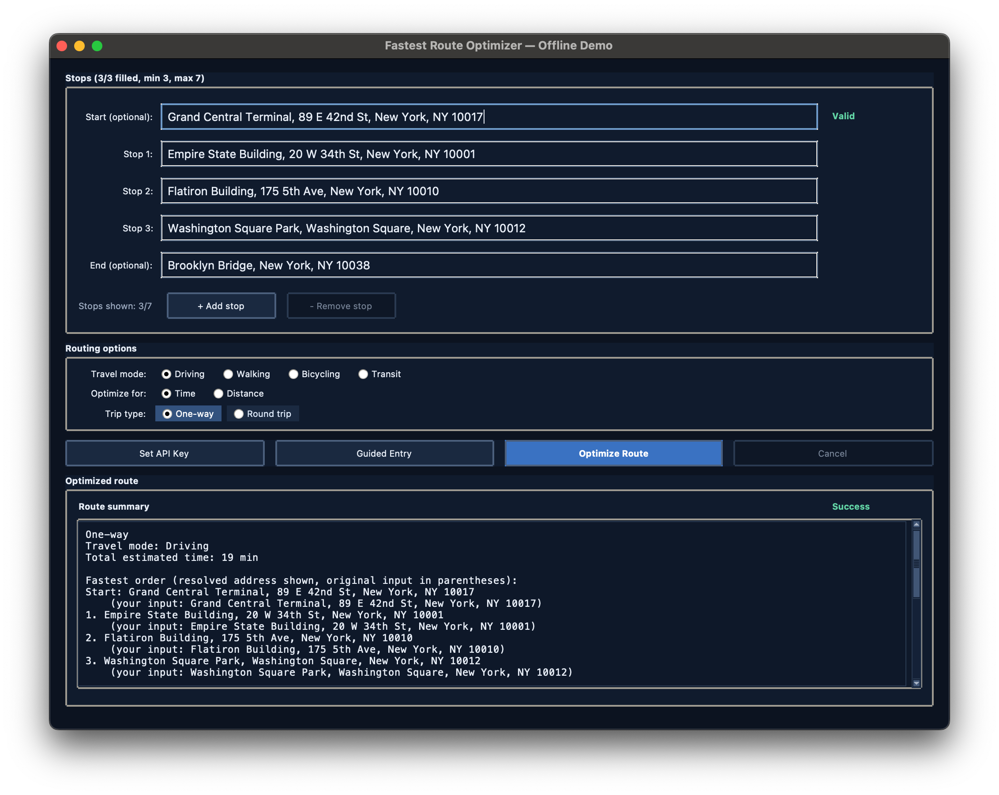

<h1 align="center">Fastest Route Optimizer</h1>

<p align="center">A typed Python desktop app that turns a set of stops into a practical time- or distance-optimized route.</p>

<p align="center">
  
</p>

<p align="center"><sub>Verified application screenshot from the deterministic offline demo; distances and durations are fixture-derived estimates, not live Google Maps data.</sub></p>

<p align="center">
  <a href="#try-it-offline">Try it offline</a> ·
  <a href="#how-it-works">How it works</a> ·
  <a href="#engineering-proof">Engineering proof</a> ·
  <a href="#design-decisions">Design decisions</a>
</p>

- **A useful demo without credentials:** the bundled NYC fixture works without an API key or
  network connection.
- **Deliberate dependency boundaries:** routing orchestration depends on core-owned matrix and
  route-cache ports, with infrastructure adapters wired in one composition root.
- **Bounded provider work:** a cold route uses one complete matrix request, with classified retries,
  rate limiting, deadlines, and cancellation checks.
- **A verified artifact:** strict typing, deterministic tests, security checks, and an isolated wheel
  installation test are part of the repository's quality gate.

## Try it offline

Use Python 3.11 with Tk support, Bash, and GNU Make. The documented contributor workflow targets
macOS and Linux; WSL can run the command-line checks but is not a native Windows GUI target.

```bash
make setup
make demo
```

The first `make setup` may need package-index access to install the locked dependencies. After that
bootstrap, the demo itself needs neither a credential nor network access.

`make demo` opens the real Tkinter UI, prefilled with supported New York City landmarks.
`DemoMapsClient` resolves those fixtures and builds deterministic distance or duration estimates
from disclosed coordinates. The resulting Google Maps link is an output convenience; opening it is
the only step that leaves the offline app.

## Add your API key

In the desktop app, click **Add API Key**, paste your Google Maps API key, and click **Apply**. The entry is masked. By default the key is used only for the current session; select **Remember on this computer** to save it in the ignored local `.env` file. No API key ships with the project.

The [website](https://liam-fastest-route-optimizer.young-hen-7947.chatgpt.site) stays a demo with sample data and never asks for your API key.

## Run with live Google Maps data

Live routing needs an existing billing-enabled Google Cloud project with Geocoding API, Places API
(Legacy), and Distance Matrix API (Legacy) access. Create the local credential file, add the key,
then start the app:

```bash
cp .env.example .env
# Edit .env and set GOOGLE_MAPS_API_KEY.
make run
```

The source checkout reads `.env` from the repository root. An installed wheel reads
`$XDG_CONFIG_HOME/fastest_route/.env`, or `~/.config/fastest_route/.env` when
`XDG_CONFIG_HOME` is unset. If the live app starts without a key, its startup flow prompts for one.
The credential file is ignored by Git and restricted to the current user on POSIX systems, but it
is still plaintext and belongs inside the workstation trust boundary.

## Product surface

The desktop flow accepts an optional fixed start, three to seven optimizable stops, and an optional
fixed end. It supports open paths and round trips; driving, walking, bicycling, and transit; and
optimization by time or distance. Address status checks, debounced autocomplete, guided multiline
entry, and ambiguity selection support input. Results include the ordered route, total and per-leg
metrics, safety notes where applicable, a copyable Google Maps URL, and CSV export.

In live mode, Geocoding, Places autocomplete, and Distance Matrix calls use the configured Google
adapters. In demo mode, the same UI and routing service use fixture-backed geocoding, autocomplete,
and matrix construction. Cooperative cancellation covers matrix waiting, retry, and rate-limit
phases, while job identity checks prevent a cancelled or superseded worker from rendering stale
results.

## How it works

<p align="center">
  
</p>

The package lives at `TSP_GOOGLE_MAPS/fastest_route`:

| Layer | Responsibility |
| --- | --- |
| `config` | Load, merge, and validate typed runtime settings. |
| `core` | Orchestrate routing and select the TSP strategy. |
| `core/ports` | Define the matrix and route-cache contracts consumed by core. |
| `infrastructure` | Provide Google Maps, offline demo, cache, retry, and rate-limit implementations. |
| `presentation` | Own Tkinter views, controllers, dialogs, and workflows. |
| `observability` | Provide structured logging, correlation context, and metrics hooks. |
| `shared` | Hold cross-layer errors, types, cancellation, and utilities. |

`fastest_route.entrypoint` is the composition root. It loads configuration, selects either
`GoogleMapsClient` or `DemoMapsClient`, wraps the selected matrix provider and the route cache in
core-port adapters, constructs `RoutingService`, and injects the same selected client into the UI
for address features. The source launcher `TSP_GOOGLE_MAPS/main.py` delegates to that package entry
point.

After the UI validates and synchronously geocodes the entered addresses, a worker asks
`RoutingService` for a route. The service checks its route cache, requests a complete directed
matrix through `RouteMatrixPort` on a miss, solves it, calculates per-leg values, and caches the
result. UI callbacks are scheduled back onto Tk's main thread and accepted only when the worker is
still the current job.

The default configuration allows seven optimizable stops. Exact search therefore handles the
default route shapes, including optional endpoints: endpoint nodes are fixed and excluded from the
exact-search threshold. Above the configured threshold, the solver uses nearest-neighbor followed
by constraint-aware 2-opt, preserving a fixed start or end and round-trip shape as required. With
both optional endpoints, the default UI can submit nine matrix locations, or 81 directed elements.

See the [architecture overview](docs/architecture.md) and
[dependency rules](docs/architecture/dependency-rules.md) for the complete boundary model.

## Engineering proof

### 1. Core owns the routing boundary

[`RouteMatrixPort` and `RouteCachePort`](TSP_GOOGLE_MAPS/fastest_route/core/ports/routing_ports.py)
keep `RoutingService` independent of Google Maps and cache implementations. The
[adapter module](TSP_GOOGLE_MAPS/fastest_route/infrastructure/adapters/routing_ports.py) performs
the concrete delegation, and [ADR 0002](docs/adr/0002-routing-ports-adapter-boundary.md) records the
decision and its cost. Contract tests verify the boundary rather than relying on architecture prose
alone.

### 2. One bounded matrix, selective retries

The live adapter requests the complete supported square matrix in one provider call when the
per-leg cache cannot satisfy it. It validates dimensions and directed elements before solving or
caching them. Transient transport failures and explicitly retryable provider states may retry;
invalid, denied, or malformed responses fail immediately. [ADR 0003](docs/adr/0003-batch-matrix-requests-and-classify-retries.md)
explains the quota, latency, freshness, and sparse-cache tradeoffs, while the
[Google Maps integration tests](tests/integration/test_google_maps_client.py) exercise the policy.

### 3. Stale work and shipped artifacts are tested

[Routing job freshness tests](tests/unit/test_routing_job_freshness.py) prove that callbacks from a
completed or cancelled old job cannot render into, or unlock, a replacement job. The
[cancellation tests](tests/unit/test_cancellation.py) cover the cooperative token contract. At the
distribution boundary, the [artifact integration test](tests/integration/test_distribution_artifact.py)
builds a wheel, installs it into an isolated virtual environment, verifies packaged configuration,
and exercises both `fastest-route` and `python -m fastest_route` outside the source tree.

## Quality workflow

Run the repository's full local gate before proposing a change:

```bash
make check
```

That gate checks Ruff formatting and linting, strict mypy, repository and lockfile hygiene, pytest
with branch coverage and a 90% threshold excluding the presentation package, package build,
Bandit, and dependency audit. Presentation behavior still has targeted unit tests; the percentage
gate excludes it because automated tests do not drive a real native Tk window.

Useful narrower targets are `make test`, `make lint`, `make format`, `make build`, `make bench`, and
`make profile`. The benchmark is a repeatable measurement artifact, not a portable cross-machine
performance threshold. Workflow definitions also configure gitleaks and CodeQL where repository
features permit, but this README does not claim a current remote CI result.

## Design decisions

- [ADR 0001: enforce dependency direction](docs/adr/0001-dependency-direction-enforcement.md)
- [ADR 0002: route through core ports and infrastructure adapters](docs/adr/0002-routing-ports-adapter-boundary.md)
- [ADR 0003: batch matrix requests and classify retryable failures](docs/adr/0003-batch-matrix-requests-and-classify-retries.md)
- [Error model](docs/architecture/error-model.md) and
  [observability model](docs/architecture/observability.md)
- [Deterministic fixture rules](docs/testing/deterministic-fixtures.md) and
  [benchmark governance](docs/performance/benchmark-governance.md)

## Important limitations

- The live integration uses Distance Matrix API (Legacy) and Place Autocomplete (Legacy). Migration
  to Routes Compute Route Matrix and Autocomplete (New), plus a review of Google provider terms and
  cache-retention policy for the intended distribution, remains necessary before presenting this as
  a production product.
- Live request construction geocodes addresses synchronously on Tk's main thread before matrix work
  moves to the worker. Cancellation and UI responsiveness do not cover that phase.
- There is no software license. Source availability does not grant permission to use, modify, or
  redistribute this project.
- Automated tests do not exercise a native Tk window, and native Windows GUI behavior has not been
  validated. No signed desktop bundle or public package release is provided.

Security guidance and incident procedures live in [SECURITY.md](SECURITY.md), the
[threat model](docs/security/threat-model.md), and the [runbooks](docs/runbooks/README.md).
