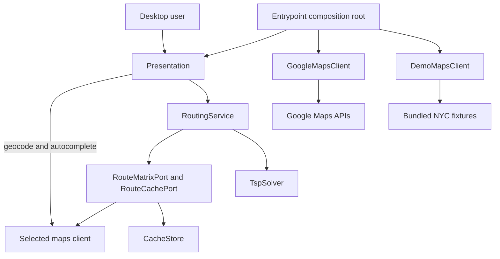

# Architecture

## Overview

Fastest Route Optimizer is a Python 3.11 Tkinter application whose routing domain is separated from
provider IO and desktop presentation. The package root is `TSP_GOOGLE_MAPS/fastest_route`.

## Layer model

| Layer | Responsibility |
| --- | --- |
| `shared` | Cross-layer types, errors, cancellation, and utilities. |
| `observability` | Structured logs, correlation context, and metrics hooks. |
| `config` | Typed configuration loading, layering, defaults, and validation. |
| `core` | Route orchestration and exact/heuristic TSP solving. |
| `core/ports` | Core-owned contracts for route matrices and route-result caching. |
| `infrastructure` | Live Google Maps and offline demo clients, caches, retry, and rate limiting. |
| `presentation` | Tkinter controllers, workflows, dialogs, views, and window lifecycle. |

Dependency direction is defined in [dependency-rules.md](architecture/dependency-rules.md) and
checked by `scripts/repo_hygiene.sh`.

## Composition root

`fastest_route.entrypoint` owns runtime wiring. It loads the stable `.env` location and validated
configuration, constructs caches, then selects a maps client:

- normal mode constructs `GoogleMapsClient` with rate-limit and retry policy;
- `--demo` constructs `DemoMapsClient`, which uses bundled landmark fixtures and creates no HTTP
  session.

`build_routing_ports` wraps the selected client's matrix behavior and `CacheStore` behind
`RouteMatrixPort` and `RouteCachePort`. Those adapters are injected into `RoutingService`. The
selected concrete client is also injected into `RouteApp` for geocoding and autocomplete.

This distinction is intentional: core ports isolate routing matrix and route-cache orchestration.
Autocomplete and request-building geocoding are presentation workflows that call the selected maps
client directly; they are not covered by the core routing ports.

## Runtime flow

1. `fastest_route.entrypoint` loads configuration and builds either the live or demo dependency
   graph. `TSP_GOOGLE_MAPS/main.py` delegates to this package-native entry point.
2. The presentation layer validates local form constraints and synchronously resolves addresses
   through the selected maps client.
3. `RoutingController` starts a worker with a fresh cancellation token and `RouteRequest`.
4. `RoutingService` checks `RouteCachePort`, then requests a matrix through `RouteMatrixPort` on a
   miss.
5. The live provider builds the complete supported matrix in one bounded request when its per-leg
   cache cannot satisfy it; the demo provider computes a deterministic fixture matrix locally.
6. `TspSolver` uses exact search when the number of optimizable nodes is at most `max_exact` and
   otherwise uses nearest-neighbor followed by constraint-aware 2-opt.
7. The service derives per-leg values and caches the route result. Presentation formats the
   summary, CSV data, and Google Maps URL.
8. Tk callbacks render only if their cancellation token still identifies the current job, so stale
   workers cannot overwrite a replacement request.

The default UI accepts seven optimizable stops. Optional fixed start and end locations can produce
nine matrix locations (81 directed elements), while those endpoints are excluded from the exact
search threshold. The configuration schema permits at most eight stops so the legacy matrix request
stays within its 100-element bound.

## Context diagram

## Operational boundaries

- Live matrix IO carries a deadline through rate-limit waits, retry backoff, and HTTP timeouts.
- Cancellation is cooperative; an active synchronous socket call cannot be interrupted instantly.
- Live geocoding occurs before the worker starts and can temporarily block the UI thread.
- Local caches are implementation details behind infrastructure adapters, but Google provider
  policy still governs whether and how provider content may be retained.
- Common operational failures are covered by the [runbooks](runbooks/README.md); security assumptions
  are recorded in [the threat model](security/threat-model.md).
